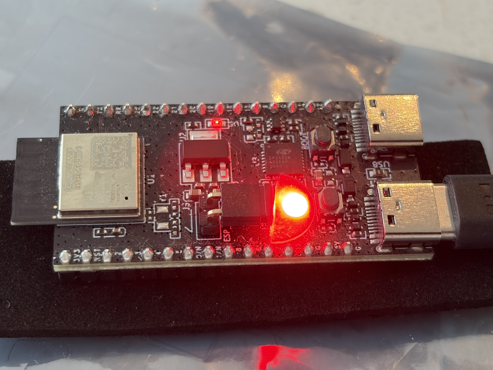

# SLED

Steering the multi-colored "super" LED of ESP32 devkits, from Rust

- within an ESP-IDF project
- from [Embassy](https://embassy.dev), providing an `async` interface
- for the presentation of internal state (e.g. debugging).

<!-- tbd. *video* (animated png) of a multiplexed LED
-->



### Supported / tested devkits
	
|MCU & devkit|feature|state|
|---|---|---|
|ESP32-C6 [DevKitM-1](https://docs.espressif.com/projects/esp-dev-kits/en/latest/esp32c6/esp32-c6-devkitm-1/user_guide.html)|`espressif_devkit_m1` (default)|🟩|
|...|

<!-- #hidden
The intention is to support most common ESP32-C6 devkits. See `features` and `DEVS/*`.
-->

### 🚥 🚥 🚥 🚥 🚥

---
>**Warning:** The Neopixel of the devkit can be <font color=turqoise>**ULTRA BRIGHT**</font> without a diffuser, when driven by the raw (C level) software.
>
>**DO NOT LOOK DIRECTLY** at the LED. Attach a piece of paper tape or a transparent bumper over the light source. Be safe!

<!-- tbd. image of a diffuser
-->

---

## Aim

SLED is intended to be a **development tool**, providing visual clues to what's going on within one's program, even when no textual logging is possible - or in addition to the logs.

Due to its multiplexing capability, **more than one information** can be included in the color stream.


## Requirements

- 1 pc ESP32-C6 devkit 

- Working Rust and Cargo
		
	- `ldproxy`

		```
		$ cargo install --locked ldproxy
		```
	
		- Needed for using `ESP_IDF_TOOLS_INSTALL_DIR = "global"`.

- OS packages

	```
	$ sudo apt install curl git pkg-config libssl-dev python3 python3-venv cmake \
	  build-essential clang just
	```

- `espflash`
	
	```
	$ espflash board-info
	[2026-10-27T17:18:01Z INFO ] Serial port: '/dev/ttyUSB0'
	...
	```

**Disk space**

The `esp-idf-sys` setup downloads and installs a whole ESP-IDF development toolchain under `~/.espressif`. 

`cargo clean` does not remove this folder, but you can do it manually, to reclaim the disk space.


### Hints (optional)

1. The author uses [EdgeVM](https://github.com/finalyards/EdgeVM) for running Rust in a VM sandbox. The `edge-vm` VM defined there already includes the below requirements.

2. You can use [probe-rs-remote](https://github.com/finalyards-org/probe-rs-remote) (GitHub) to keep the DUT physically separate from the development computer.

3. Consider setting a higher-than-default baud rate to `espflash`.

	```
	$ cat ~/.config/espflash/espflash.toml 
	baudrate = 2000000
	```
	
	>If you use `probe-rs-remote`, this is done in the remote account that physically connects to the devkit.


<!-- Author's environment
- ESP32-C6 DevKitM-1

- Lima VM 2.3.0-rc.0
- Ubuntu 26.04, within the VM
- `espflash` 4.7.0, remoted via `probe-rs-remote`
-->


## Steps

```
$ cargo run --release -vv --example c
...
```

>Note: The first build downloads the ~5GB of ESP-IDF toolchain, so be patient.

<!--
tbd. Video when running the particular example.
-->


## API design

This is likely pretty obvious, by looking at the `examples` sources, but as a commentary, some points:

```
static PING_ANIMATION: ButtonPing = ButtonPing::new();
```

The set of animations (states to be made visible via the LED) is intentionally static - defined at build time.

You may have states that are in passive state (not affecting the output); this should provide enough dynamicity. The author feels having a static set is meaningful and simple for the application programmer.

*tbd. complete once demos are <font color=green>G</font><font color=blue>R</font><font color=red>E</font><font color=white>A</font><font color=orange>T</font>*.


## References

- ["Example: Driving WS2812 LEDs with RMT"](https://docs.waveshare.com/ESP32-ESP-IDF-Tutorials/Rmt-Drive-Ws2812) (Waveshare)
